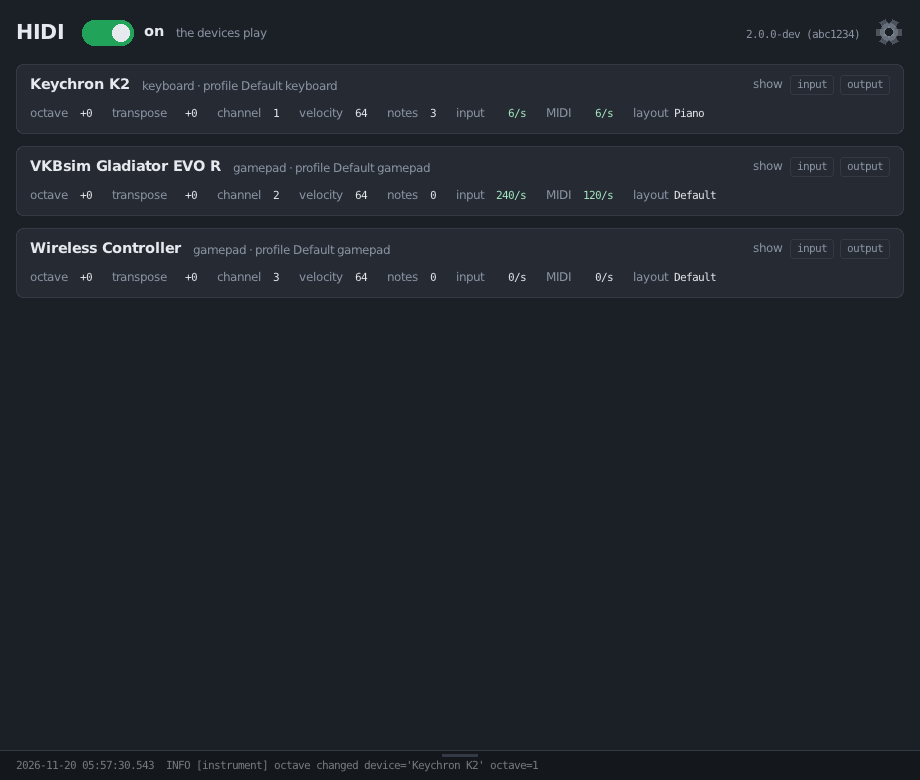
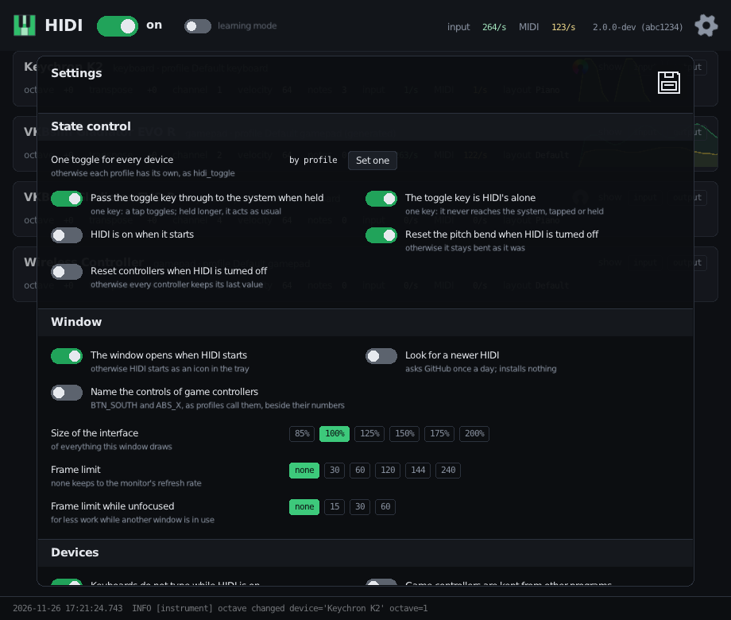
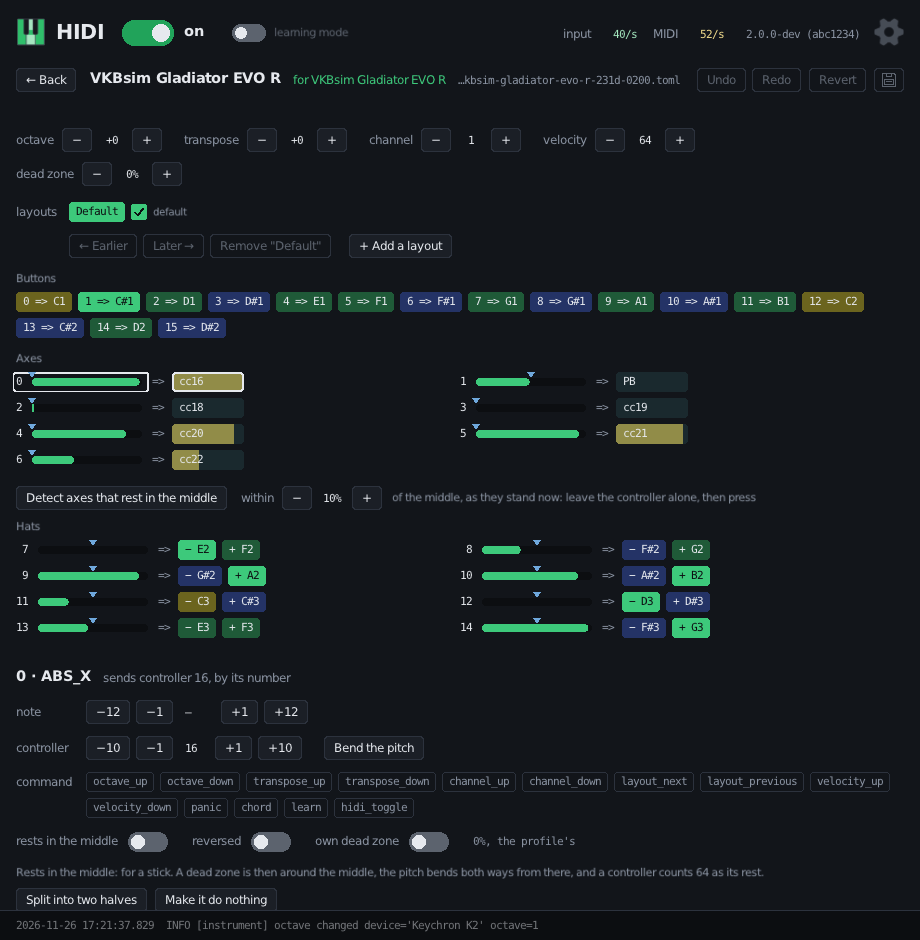
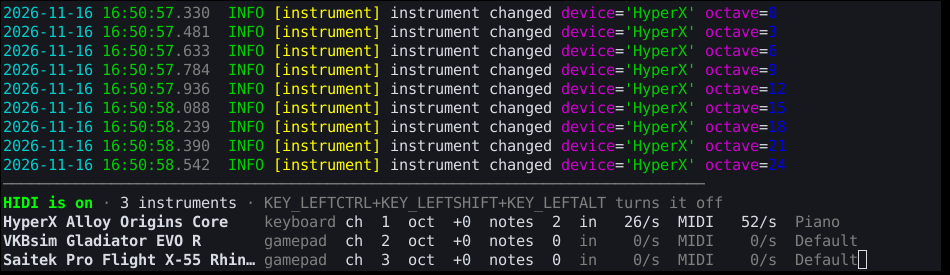
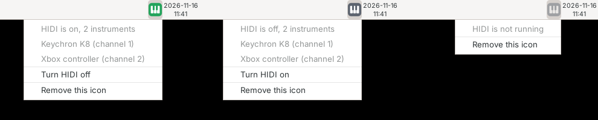

# HIDI

HIDI turns computer keyboards and game controllers into MIDI instruments.
Play notes on the letter keys, bend pitch with a stick, send control changes
from a throttle: every input device becomes a MIDI device of its own that a
DAW or a synthesizer can listen to.


> **This is HIDI 2.0 before its release.** It runs on Linux and on
> Windows 11, where it is a preview. The released version is 1.x, on the
> [`main` branch](https://github.com/gethiox/HIDI/tree/main) and the
> [releases page](https://github.com/gethiox/HIDI/releases). Configuration
> files from HIDI 1.x do not work with 2.0.


## What it does

- Every keyboard and game controller becomes one MIDI device, named `HIDI`
  followed by the device's name. It appears when the device is plugged in
  and goes when it is unplugged.
- Keyboards do not type while you play them. A key combination turns HIDI
  off and gives them back, and on again.
- What each key, button and axis does is written in a profile, a text file
  for each kind of device. HIDI follows changes to it while it runs, and the
  window can change it for you.
- It runs as an icon in the tray with a window, or in a terminal on a
  machine without a screen.
- It can send to a hardware MIDI interface directly, and light the keys of a
  keyboard by what they play.

## Contents

- [Installing](#installing)
- [Starting HIDI](#starting-hidi)
- [Playing](#playing)
- [The window](#the-window)
- [In a terminal](#in-a-terminal)
- [Settings and profiles](#settings-and-profiles)
- [Sending to a hardware MIDI interface](#sending-to-a-hardware-midi-interface)
- [Lighting the keys](#lighting-the-keys)
- [Windows](#windows)
- [When something does not work](#when-something-does-not-work)
- [Building from source](#building-from-source)

More to read: the [configuration reference](docs/configuration.md) for the
settings and the profile format, [how HIDI is built](docs/architecture.md),
and [what is done and what remains](docs/roadmap.md).

## Installing

HIDI is one program file, `hidi` (`hidi.exe` on Windows). On Windows the
libraries it needs lie beside it in the archive: keep the files of the
archive together. Take the archive for your system from the
[releases page](https://github.com/gethiox/HIDI/releases) and unpack it, or
[build it from source](#building-from-source).

### Linux

HIDI reads input devices from `/dev/input` and creates MIDI devices through
the ALSA sequencer. It does not need root. It needs your user to have access
to both; most distributions give sound to whoever is logged in at the
machine already. For the input devices there are two ways.

The udev rule that comes with HIDI, `70-hidi.rules`, gives them to whoever
is logged in at the machine's own screen and keyboard, for as long as they
are:

```bash
sudo cp 70-hidi.rules /etc/udev/rules.d/
```

```bash
sudo udevadm control --reload
```

```bash
sudo udevadm trigger --subsystem-match=input --subsystem-match=misc
```

Or make your user a member of the `input` group, and of `audio` where sound
is not handed out by login, then log out and back in:

```bash
sudo usermod -aG input,audio "$USER"
```

Either way, every program you run can then read every key pressed on the
machine, which programs under X11 can do anyway.

`hidi.desktop` is an entry for the desktop's menu. Copy it to
`~/.local/share/applications/` once `hidi` is somewhere on your `PATH`.

HIDI for 64-bit processors (`linux-amd64`, `linux-arm64`) needs a few
libraries of the system, which a desktop has: the C library (glibc),
`libX11.so.6` for the window, and `libffi.so.8` (`libffi8` on Debian and
Ubuntu, `libffi` on Fedora and Arch). Without them it does not start at
all, also without a window. On Wayland the window runs through XWayland.

For a machine without a desktop, a server or Raspberry Pi OS Lite, take
`linux-amd64-headless` or `linux-arm64-headless`: HIDI without the window,
which needs no library at all and runs in a terminal or as a service. So
does HIDI for 32-bit ARM (`linux-armv6`, `linux-armv7`, the 32-bit
Raspberry Pi OS), which has no window either.

### Windows

HIDI needs Windows 11 25H2 or later, because it creates its MIDI devices
through Windows MIDI Services. `hidi.exe` is not signed, so on the first
start Windows SmartScreen may warn about it: "More info", then "Run
anyway". See [Windows](#windows) for what else there is to know before the
first start.

## Starting HIDI

Start `hidi` from the desktop's menu, by a double click, or from a terminal:

```bash
hidi
```

The window opens, and an icon appears in the tray. HIDI starts turned off:
the keyboard types as always until you turn HIDI on, with a tap on Caps
Lock or the switch at the top of the window. Closing the window leaves HIDI
running as the icon.

- A click on the icon opens the window.
- A click with the middle button turns HIDI off and on.
- While learning mode is on, the icon blinks between green and yellow.
- The icon's menu lists the instruments, turns HIDI on and off, and ends it
  with "Quit HIDI".
- The icon tells whether HIDI is on or off: its keys are green while HIDI
  is on and grey while it is off.

To start as the icon alone, turn off "The window opens when HIDI starts" in
the settings; `hidi --window` then opens it once. "HIDI is on when it
starts" is there too. Starting `hidi` while it runs already opens the
window of the one that runs.

On Linux the icon needs a desktop that shows such icons the modern way
(StatusNotifierItem): KDE, Xfce, the bars of Wayland compositors such as
Waybar, and GNOME with the AppIndicator extension. On a desktop without one,
HIDI opens its window instead, and closing the window ends HIDI.

For a machine without a screen, or to have nothing but the instruments, see
[In a terminal](#in-a-terminal).

## Playing

With the profiles HIDI comes with, a keyboard plays notes on its letter
rows, laid out like a piano.

| Keys | What they do |
|---|---|
| F1, F2 | Octave down, up |
| F3, F4 | Transpose down, up |
| F5, F6 | MIDI channel down, up |
| F7, F8 | Velocity down, up, by 16 from 64 as HIDI comes (the settings change the step) |
| F9 | Remember the chord that is held; every key then plays it |
| F10 | Learning mode |
| F11, F12 | Previous, next layout |
| Escape | Silence everything |

The modifier keys, the space bar, the arrows, the six keys above them,
Print Screen, Scroll Lock and Pause, and the media keys (previous,
play/pause, next, stop, mute, volume down and up) are left to the system in the
two layouts that play notes: they type, also while HIDI plays, so that the
program played into can still be worked. Every layout has its own commands
and keys of this kind, and the window changes them layout by layout.

A game controller of any kind, a pad, a stick, a throttle or a wheel,
plays notes on its buttons, from C1 up in the order of their numbers, and
sends a controller from each axis, from controller 16 up. The stick, or the
left one of two, bends the pitch, and that is the one thing the profile
names: every button, the directions of a hat or a direction pad among them,
plays a note. HIDI has no profiles for single products: it asks each controller what it has and gives
everything a part by its number, the same every time. What exactly, and
everything else, is in the [profiles](#settings-and-profiles).

### Turning HIDI off and on

While HIDI is on, keyboards are taken away from the rest of the system, so
that playing does not type. That includes the keyboard you started HIDI
with. To get it back, tap the toggle key:

**Caps Lock**, pressed and let go within half a second.

Another tap turns HIDI back on. While HIDI is off the instruments are
silent and their MIDI devices stay in place. Turning off ends every note
and puts the pitch bend back to no bend; controllers stay as they were last
sent, a volume for one, and both can be set otherwise. Game controllers are not taken
away, so they keep working in other programs.

A tap of Caps Lock no longer switches capitals, whether HIDI is on or off;
held for longer than half a second, the key is passed through to the
system and does what it normally does. With "Pass the toggle key through
to the system when held" turned off in the settings, the key is HIDI's
alone, tapped or held. On Linux this needs the udev rule that comes with
HIDI; see "One key that turns HIDI off and on" in the
[configuration reference](docs/configuration.md).

The toggle belongs to the profile: the keyboard profile HIDI comes with
binds Caps Lock to the command `hidi_toggle`, and a profile of your own can
bind another key, or several pressed together such as left Ctrl, Shift and
Alt. The settings can name one toggle for every device instead. A keyboard
that has no toggle either way is not taken away: it plays and keeps typing,
since nothing on it could turn HIDI off again, and its card in the window
says so.

## The window

Each instrument has two lines: its name and profile, and its state. Behind
them runs a curve of the last twelve seconds, a tenth of a second at a
time: green for what came in from the device, yellow for what went out as
MIDI. The two numbers for it take
the same colours while they are not zero, and the top of the window has them
for all instruments together.
The switches "input" and "output" beside "show" add what the device reports
and what goes out as MIDI because of it: the notes that are on, and a bar
for every controller the instrument sends and for the pitch bend, with the
value last sent (0 to 127, and -100% to +100% for the pitch bend), in the
order of the axes that drive them. The window remembers the switches for
every device.

A keyboard is drawn as a full-size keyboard. Every key has the colour of
what it does in the layout that is selected, and the keys that are down
stand out. Where HIDI lights the keyboard through OpenRGB, the keys also
glow in the colours of their lights, so the drawing shows what the keyboard
shows. A game controller shows all the buttons and axes it has, numbered
from 0: the numbers are the same whenever a controller of that kind is
plugged in. "Name the controls of game controllers" in the settings shows
the names profiles use beside the numbers, such as BTN_SOUTH and ABS_X. A
controller that cannot say what it has shows its controls by name as they
are used.
While HIDI is off, what is pressed shows in grey.

Every keyboard has the sign of OpenRGB, a ring of colours, beside "show". It is
in colour where HIDI drives the keyboard's lights and grey where it does
not: no OpenRGB, or a keyboard OpenRGB does not know. Click a grey one and
the drawn keyboard shows what the lights would show; the sign is yellow
meanwhile, and another click ends it. Nothing is sent to the keyboard.

The small switch beside it is learning mode, for teaching a program which
controller to listen to: every axis stands still until it is moved by more
than half of its range, so that the program hears only the one you mean.
The icon in the tray blinks green and yellow meanwhile, and its menu has the
switch too.



The switch at the top turns HIDI on and off.

The log lives in the bar at the bottom, which shows its last line, faint.
Pull the bar up, or click it, for the whole log; the row below the bar
chooses the least severe level to show. What an instrument does as it is
played, a changed octave or channel, a chord, and HIDI being turned on and
off, is logged at the lowest level, DEBUG, and shows when that is chosen.
The window always opens with the log folded away.


### Settings

The gear in the upper right corner opens the settings as a sheet over the
instruments. A click beside the sheet closes it.



What is in `settings.toml` can be changed there, in sections: state
control, the window, the devices, MIDI, the lights, and the profiles.
A change is in use at once: the running HIDI follows it as you make it, so
turning on the lights lights them, and a colour changes on the keyboard
while its slider moves. It is not written, though, until you save, with the
disk in the corner of the sheet or Ctrl+S. Saving writes the file and does
nothing else. The disk is yellow while something is in use that is not
saved, and "Revert" beside it takes it back. Closing the window changes
nothing: HIDI keeps going by what is in use, and the window shows that, and
that it is not saved, when it opens again. A few settings matter only when
HIDI starts, and say so. A setting that only the other system has is shown
greyed out.

- "One toggle for every device" shows "by profile" as HIDI comes: each
  profile says which key turns HIDI off and on. "Set one" takes a key, or
  several pressed together, from the keyboard and makes it the toggle for
  all devices; "Use the profiles'" goes back.
- "Pass the toggle key through to the system when held": a toggle of one
  key works by a tap, and held longer the key does what it normally does.
- "Reset the pitch bend when HIDI is turned off", on as HIDI comes, and
  "Reset controllers when HIDI is turned off", off as HIDI comes: what
  turning off puts back to rest beside ending the notes.
- "Hysteresis of axes that act as buttons": how far past its trigger point
  an axis has to go to count as pressed, and behind it to count as let go,
  half of the value each way. 2 % as HIDI comes; 100 % means pressed at
  the far end and let go at rest.
- "Devices that play" chooses which devices become instruments: with
  "blacklist" every one except those you tick, with "whitelist" only those
  you tick. The list has the devices that are connected and, after them and
  in grey, those that were unplugged since HIDI started and those the
  settings name.
- "Also send to MIDI ports" lists the MIDI ports that exist. A click on one
  makes every instrument send there as well.
- "OpenRGB server" is where the lights are sent: an address and a port.
  Left empty it is the usual place, shown faintly. It can be changed while
  the switch above it is off.
- "Colours of the keys" are the colours of the lights. Click one and move
  the three sliders.
- "Size of the interface" draws everything in the window smaller or larger,
  from 85 % to 200 %. The window follows at once, and keeps the size when
  you save.
- "Pass the toggle key through to the system when held" lets a toggle of
  one key, such as Caps Lock, do what it normally does when it is held;
  turned off, the key is HIDI's alone, held or tapped.
- "Look for a newer HIDI" lets the window ask GitHub once a day whether
  there is a newer release. It is off unless you turn it on. The answer is
  in the lower right corner of the window, grey while HIDI is up to date
  and yellow when there is a newer one; a click opens its page. Nothing is
  downloaded or installed.

Below them is HIDI's directory, with a button that opens it in the file
manager, and every profile, also those of devices that are not connected,
in two groups. "Yours" are your own: each has a switch that turns it off
without removing it, "Edit", "Show in folder", and "Delete", which asks
before it removes the file. One that stands in for a factory profile, for
every device of a kind, says "(factory override)" in yellow and has a
yellow switch; one for a single product looks like any other. "Factory"
are the ones
HIDI comes with, which it keeps as they are: "View" shows one, and
"Customise" makes a copy of your own, used in its place, and opens it.

The window is drawn at the refresh rate of the monitor it is on, and only
when something it shows has changed, so an idle window costs next to
nothing. "Frame limit" lowers that rate, and "Frame limit while the window
is unfocused" lowers it only while another window is in use.

### Changing a profile

"Edit profile" on an instrument, or "Edit" beside a profile in the settings,
opens the profile. A factory profile is shown and cannot be changed;
"Customise Default" on its page makes the copy of your own that can. The
page shows the numbers an instrument starts with, the layouts, and what
every control does, with what the device is doing at this moment laid over
it.

Opened from an instrument's card, the page is for that device, and says so
beside the name of the profile: "for" and the name of the device. It shows
what that device has and what the profile's rule makes of it, also where
several controllers play with the same profile. A factory profile that
gives most controls their parts by its rule says "(generated)" behind its
name, here and on the card of an instrument that plays with it; a profile
of your own does not.

A keyboard's profile is drawn as a keyboard, coloured by what the keys do,
and the keys that are down are marked. Keys the drawing has no place for,
media keys for one, show up in a row "Other keys" once they have been
pressed, and are changed like the rest.

A game controller's profile has three groups:

- **Buttons** are chips, lit while pressed: the number of the button,
  "=>", and what it does ("12 => C2").
- **Axes** are lines: the number, a bar for where the axis stands, "=>",
  and what it is mapped to. A small blue triangle above the bar points at
  where the axis rests as the profile reads it: in the middle for a
  stick, at an end for a lever. A controller ("cc16") or the pitch bend
  ("PB") is a chip that fills by the value it sends; a note or a command
  lights up while it counts as held.
- **Hats** are lines with their two directions as two chips, each a
  button of its own.

Numbers are the ones the main page shows. With "Name the controls of game
controllers" the names profiles use stand beside them.

What lights up and fills is not an estimate: the page runs the profile as
it is shown through the same engine HIDI plays with, fed with what the
device does, so dead zones, trigger points and the hysteresis show as they
work, also while HIDI is off.

Mappings ringed in yellow send a controller, or bend the pitch, that
another control sends too. That is allowed, and the two overwrite each
other.

"Detect axes that rest in the middle", below the axes of a profile of your
own, looks at where the axes stand at that moment: one within the given
distance of its middle (10 % as it comes) is taken for a stick, the others
for levers, and "rests in the middle" is set for all of them at once.
Leave the controller alone when you press it.

Click a control, or press it on the device, and make it play a note, send a
controller, run a command, or do nothing. Drag one onto another and the
two swap what they do; hold Ctrl while doing so to copy it instead. The
right mouse button empties a control; with Ctrl it leaves a key to the
system. Among the commands of a key is `hidi_toggle`, which makes it the
key that turns HIDI off and on for devices with this profile.

On a game controller's profile, what the profile's rule gives a control by
its number is drawn hollow; a control with a line of its own is filled.
"Back to the rule" takes a control's own lines out of the layout, and the
rule's part comes back. "Reset" makes the whole profile anew of what it was
made of: your copy of a factory profile of that factory profile, and a
profile for one device of your profile for its kind of device, where you
have one that is used, or else of the factory one. Undo takes a reset back,
and nothing is written until you save.

An axis can be anything a button can, and more:

- a controller or the pitch bend, with "rests in the middle" for a stick
  (a dead zone is then around the middle, the pitch bends both ways from
  there, and a controller counts 64 as its rest) and "reversed". The dead
  zone is the profile's, which is among the starting values at the top of
  the page and 0 % unless set; "own dead zone" gives the axis one of its
  own;
- a note or a command, triggered when the axis passes a point you set
  ("triggers at", half of its way unless changed). How far past the point
  it has to go, and how far back to let go, is the hysteresis in the
  settings;
- two halves bound apart. "Split into two halves" turns a controller into
  two, one for each direction from the middle, so that a stick at rest
  sends 0 on both instead of 64 on one; each half is then chosen by its
  chip and changed like a button. "Join the halves" is the way back.

With a game controller connected, the page lists everything the controller
has. Most of it has no line in the profile and plays "by its number";
changing such a control writes a line for it, and emptying it writes that
it does nothing.



A change to the profile for game controllers applies to all of them.
"Customise for specific device", at the top of the page, unfolds the
devices that play with the profile, the one the page was opened for tinted
green; a click on one makes a profile of your own for that product alone,
out of what the page shows, and opens it. The device plays with it from
then on; the others stay as they were.


Nothing is written until you save, with the disk in the corner or Ctrl+S.
The disk is yellow while what is shown differs from the file: a key dragged
away and back leaves nothing to save. A running HIDI plays with the profile
as it is shown, saved or not, so a change can be tried at once; the file
counts again when you take the changes back. "Undo" and "Redo", or Ctrl+Z
and Ctrl+Y, go back and forth through the changes, and "Revert" puts the
page back to what the file says in one step. If you
leave the page with changes on it they stay there, and a yellow dot on the
way back to it says so.

The row of layouts chooses the one that is shown. The box beside a layout
makes it the one an instrument starts with. Below it are the buttons that
move the layout earlier or later in the row the player steps through, remove
it, and add a new one.

The keys for all this reach the window only while the keyboard is not
HIDI's alone: turn HIDI off, or use the buttons.

Saving changes the lines that changed and nothing else: notes you wrote into
the file by hand stay. Program changes, keys that need a modifier and the
options of a note are shown where they apply and changed in the file. So is
making a new profile.

The window needs 64-bit Linux or Windows with OpenGL 3.3.

## In a terminal

```bash
hidi --headless
```

runs the instruments only, without the icon and the window, until Ctrl+C.
`hidi run` is another way to write it. The last lines of the terminal show
what HIDI is doing: whether it is on, and for every instrument its channel,
octave, the notes that sound, and how many events came in from the device
and how many MIDI messages went out in the last second. The log runs above
them.



HIDI starts turned off here too, and says so in its log. Tap Caps Lock, or
run `hidi on` from elsewhere, to turn it on; `hidi --headless --on` starts
it turned on, which is what a machine without a screen wants, and
`start_on = true` in the settings does the same for good.

Remember that the keyboard you type on stops typing while HIDI is on: turn
it off with the toggle before pressing Ctrl+C, or start with `--no-grab`.

Options are written with two dashes, `--no-grab` or
`--toggle=KEY_CAPSLOCK`; those of one letter take one, `-v`. They are the
same for `hidi` and `hidi --headless`, and each overrides its setting in
`settings.toml` for this start.

| Option | Effect |
|---|---|
| `--headless` | Run the instruments only, without the icon and the window. |
| `--window` | Open the window at once. |
| `--toggle KEYS` | One toggle for every device, in place of the profiles' own: `--toggle KEY_SCROLLLOCK`, or `--toggle KEY_LEFTCTRL+KEY_RIGHTCTRL` for keys pressed together. |
| `--toggle-tap` | A toggle of one key works by a tap and is passed through to the system when held, as it is unless the settings say otherwise. |
| `--no-grab` | Leave keyboards usable by the system; they type while you play. |
| `--grab-gamepads` | Also take game controllers away from other programs. |
| `--on` | Start turned on, whatever the settings say. |
| `--off` | Start turned off, which HIDI does unless the settings say otherwise. |
| `--connect PORT` | Also send to an existing MIDI port; see below. |
| `--openrgb ADDRESS` | Light the keys through OpenRGB; see below. |
| `--config DIR` | Use another directory for HIDI's settings and profiles. |
| `--profiles DIR` | Read profiles from another directory, beside the built-in ones. |
| `-v`, `--verbose` | Also log details, such as every ignored device. |
| `--log-midi` | Also log every MIDI message sent. It is for finding faults: an instrument sends hundreds a second. |
| `--no-status` | Write the log only, without the lines about HIDI's state. |
| `--no-color` | Write the log without colours. |

The log is coloured when it goes to a terminal, and plain when it goes to a
file or a pipe; then the lines about the state are left out too. Setting the
`NO_COLOR` environment variable turns the colours off; `FORCE_COLOR` keeps
them when the output is piped.

### Looking at a running HIDI

From another terminal, or from a script:

| Command | What it does |
|---|---|
| `hidi status` | Show the instruments and their state. |
| `hidi monitor` | The same, kept up to date, with the end of the log. |
| `hidi off`, `hidi on`, `hidi toggle` | Turn HIDI off or on, like the toggle. |
| `hidi gui` | Open the window. |
| `hidi tray` | Show an icon for a HIDI that runs without one. |
| `hidi devices` | List the input devices and the profile each would use. |
| `hidi ports` | List the MIDI ports HIDI can also send to. |
| `hidi config` | Show where the settings and profiles are. |
| `hidi profiles` | List the profiles and what is wrong with those that cannot be used. |
| `hidi doctor` | Check that this system can do what HIDI needs. |

`hidi off` is useful as a desktop shortcut. `hidi <command> --help` lists
the options of a command.

`hidi gui` and `hidi tray` only look at the running HIDI: closing them stops
nothing, and they wait for a HIDI that is not running yet. The icon of
`hidi tray` turns HIDI on and off with a click, and removing it leaves HIDI
running. It is for a HIDI started with `--headless`, by a service for
instance.



## Settings and profiles

On its first start HIDI creates its directory, `~/.config/HIDI` on Linux and
`%AppData%\HIDI` on Windows:

- `settings.toml` holds HIDI's own settings: what is grabbed, where else to
  send, the lights, the window.
- `profiles` holds one file for each kind of device, which says what its
  keys, buttons and axes do: in `profiles/factory` those HIDI comes with,
  which it keeps as they are, and in `profiles/user` your own, which come
  first.

Nothing else is kept there. What HIDI notes for itself, which files it
wrote and how the window was left, is in a directory of its own that stays
on the machine: `%LocalAppData%\HIDI` on Windows, `~/.local/state/HIDI` on
Linux.

`hidi config` shows where they are, and the settings in the window have a
button that opens the directory. To change what a device plays, make a copy
of its factory profile your own, with "Customise" in the window or by
copying the file into `profiles/user`, and change that, by hand or in the
window; HIDI picks up changes while it runs. Both formats
are described in the [configuration reference](docs/configuration.md).

## Sending to a hardware MIDI interface

Every instrument is a MIDI device of its own that other programs connect to.
HIDI can also send straight to a MIDI port that already exists, such as a
USB MIDI interface with a synthesizer behind it, which is what a
single-board computer without a screen needs:

```bash
hidi ports
```

```bash
hidi --headless --connect "USB MIDI"
```

`--connect` takes a part of the port's name, or its ID from the first column
of `hidi ports`, and may be given several times; `connect` under `[output]`
in the settings does the same for every start. The port does not have to
exist yet: HIDI connects when it appears, and again after it was unplugged.
This works on Linux only so far.

## Lighting the keys

HIDI can show an instrument on the lights of its keyboard, through
[OpenRGB](https://openrgb.org), a program of its own that has to be running
with its SDK server turned on:

```bash
hidi --openrgb 127.0.0.1:6742
```

or `openrgb = true` under `[lights]` in the settings. HIDI does not come
with OpenRGB and works without it; the lights follow when the server runs,
also when it starts later.

- Keys that play are lit by what they play: every C in one colour, the other
  white keys of a piano in a second, the black ones in a third. Keys that do
  nothing are dim red.
- A key whose note sounds turns white.
- The command keys show state: the octave and transpose keys grow brighter
  the further they have been used, the layout keys dim at the first and last
  layout, the channel keys take the colour of the channel, panic is red.
  The key of learning mode is yellow, dim until the mode is on, and then
  blinks together with HIDI's icon; the chord key is bright while a chord
  is remembered; the two velocity keys are cyan, as bright as the velocity
  is high.
- Keys that are left to the system have a colour of their own.
- While HIDI is off the keyboard is lit evenly, and types; a key that is
  held lights up.

Every one of these colours can be changed, in the window's settings or under
`[lights.colours]` in `settings.toml`.

How fast the lights follow is up to the keyboard, which takes some tens of
milliseconds to be written. HIDI sends a change at once and the next one as
soon as OpenRGB has taken the one before, so nothing queues up behind a slow
keyboard.

With the lights on, each instrument's MIDI device can also be sent to. Notes
another program sends there, a DAW playing a track for one, light the keys
that would play them: white on the instrument's own channel, in the colour
of their channel otherwise. On Windows that part is not there yet.

## Windows

**HIDI on Windows is a preview.** It rests on Windows MIDI Services, the new
MIDI system of Windows 11, which is itself new and still has faults. Expect
rough edges, and please report what you find.

### What is needed

- Windows 11 25H2 or later.
- The Windows MIDI Services API, which Microsoft is to make part of
  Windows from 2027. Until then `Windows.Devices.Midi2.dll` has to lie in
  the same folder as `hidi.exe`, with the `.pri` file of the same name. The
  zip archive of a release has both, Microsoft's preview of the API under
  its own licence, so keep the files of the archive together. `hidi doctor`
  says whether the API was found. If you build HIDI yourself, take the two
  files from the NuGet package `Windows.Devices.Midi2.<version>.nupkg` on
  the releases page of [microsoft/MIDI](https://github.com/microsoft/MIDI/releases);
  the package is a zip archive. Do not use the copy that Microsoft's Tools
  installer places next to its own programs.
- `raylib.dll`, which draws the window, and `libffi-8.dll`, through which
  HIDI calls it, beside `hidi.exe`, as the archive has them. They are under
  their own licences, in `raylib-LICENSE.txt` and `libffi-LICENSE.txt`.
  HIDI built yourself without the tags `extlib` and `ffi_no_embed` carries
  them inside and writes them out at the start, under `%TEMP%` and
  `%LocalAppData%`; see [Building from source](#building-from-source).

### In a command line

`hidi.exe` opens no console window: a double click starts the icon in the
tray and nothing else. Started from a command line it writes there, so
`hidi status`, `hidi doctor` and the others work as on Linux, with one
difference: the command line does not wait for a program of this kind. The
prompt returns at once and HIDI writes below it. `start /wait hidi doctor`
makes `cmd` wait, and sending the output somewhere, as in
`hidi doctor > report.txt`, works as usual. `--console`, with any command,
gives HIDI a console window of its own, which suits a shortcut:
`hidi.exe --console --headless`.

### What is different from Linux

- **No keyboard types while HIDI is on.** Windows cannot keep one keyboard
  from typing and let another type. The toggle gives them all
  back.
- **A grabbed keyboard is told apart by where you last typed.** While
  keyboards are kept from typing, Windows does not say which keyboard a key
  comes from. The keys go to the instrument of the keyboard that typed last
  before HIDI was turned on. With one keyboard this does not matter. With
  two, turn HIDI off, press a key on the one you want to play, and turn it
  on again. With `--no-grab` every keyboard is its own instrument at all
  times, and types while you play.
- **Game controllers always keep working in other programs.**
  `--grab-gamepads` has no effect.
- **Xbox controllers**, and those that imitate one, are read through XInput
  and are all named "Xbox controller"; Windows knows four of them at most.
  Every other controller is read as the HID device it is, with every button
  it has: a stick with a hundred and twenty-eight, of which a modifier
  brings up the upper ones, has them all. (Linux itself stops at eighty
  buttons for a joystick.)
- Sending to existing MIDI ports (`--connect`, `hidi ports`) and receiving
  notes for the lights are not there yet.

### If MIDI stops working

The MIDI service of Windows has a fault, known to Microsoft
([microsoft/MIDI#1047](https://github.com/microsoft/MIDI/issues/1047),
[#1236](https://github.com/microsoft/MIDI/issues/1236)): after a program's
MIDI devices are removed, or the program ends, the service can hang. Then
HIDI takes long to end, the next start cannot create a MIDI device, and no
other program gets MIDI either. Microsoft has announced the repair for the
Windows update at the end of November 2026. Until a machine has it, this can
happen whenever HIDI stops, and HIDI cannot prevent it.

Restarting Windows clears it, but is not needed. `Restart-Service midisrv`
does not help, because the hung service does not stop. Ending its process
does; in a terminal opened as administrator:

```
taskkill /F /IM midisrv.exe
```

Windows starts the service again when a program asks for MIDI. A HIDI that
is running notices that the service was restarted and creates its MIDI
devices anew within a few seconds; a DAW may have to be told to look for
them again.

## When something does not work

```bash
hidi doctor
```

checks what HIDI needs, step by step, and says where it fails: whether the
input devices can be read, and whether a MIDI device can be created. It
creates three MIDI devices, plays a C major chord on the first, removes
them, and creates one more to see that removing left the MIDI system
working. On Windows it also prints the Windows build and where it found
Windows MIDI Services.

| What you see | What to try |
|---|---|
| No instruments | `hidi devices` lists what HIDI finds. On Linux, see [the access to input devices](#linux). |
| The keyboard does nothing | HIDI is on and has it. Press Left Ctrl + Left Shift + Left Alt together. |
| A device plays the wrong things | `hidi devices` names the profile it uses; change it, or write one for the device. |
| A profile is ignored | `hidi profiles` says what is wrong with it, line by line. |
| Nothing arrives in the DAW | Look for a MIDI input named `HIDI` and the device's name. On Linux, `aconnect -l` lists them. |
| HIDI ended badly | The next start names a file with what happened. Please include it when you report the fault. |

`hidi --headless -v` logs every device HIDI looked at and why it left it
alone, and `--log-midi` every MIDI message it sends.

### Valve's Steam Controller

On Linux the kernel's `hid-steam` driver presents Valve's controllers as
game controllers, and HIDI plays them like any other: the stick bends the
pitch, the trackpads and triggers send controllers, the buttons and paddles
play notes. A profile written for them, which names each control, is among
the [examples](docs/examples/profiles).

- Steam must not be running. While it is, it takes the controller for
  itself and the kernel takes the game controller away.
- The controller of 2015 works with any current kernel. While HIDI has it
  open, its pads stop moving the mouse.
- The controller of 2026 and the Steam Deck's controls need a kernel that
  knows them; for the controller of 2026 that is a very recent one. They
  start as a mouse and keyboard, and send nothing to HIDI until you hold
  the button with the three lines (Start) for half a second, which
  switches them to being a game controller. The same again switches back.
- The motion sensors show up as a part called "Motion Sensors", which
  plays nothing unless a profile names its axes.

On Windows HIDI reads the controller of 2026 itself, by cable, by Bluetooth
and through its wireless receiver. Windows only sees a mouse and a keyboard
in it; HIDI tells the controller to stop being those and listens to what it
reports of its own. When HIDI ends, the controller is a mouse and a keyboard
again. Close Steam first: two programs telling the controller what to be do
not get along. This part was written from the Linux driver without a
controller at hand, so tell what you find.

The controller of 2015 and the Steam Deck's controls are not read on Windows
yet. With Steam running and its controller support turned on, Steam presents
them as an Xbox controller, which HIDI plays like any other.

### Beside an input remapper

A program such as [input-remapper](https://github.com/sezanzeb/input-remapper)
takes a keyboard for itself and passes its keys on through a device of its
own, named like "input-remapper ... forwarded". HIDI then gets nothing from
the keyboard itself and says so in its log; the instrument to play is the
forwarded one. What the remapper types by itself arrives through its
"input-remapper keyboard", which is an instrument too.

## Building from source

HIDI needs Go 1.27 or later and no C toolchain.

```bash
CGO_ENABLED=0 go build ./cmd/hidi
```

Without `CGO_ENABLED=0` the program is built without the window. The tag
`headless` leaves the window out on purpose, for the programs of the
release for machines without a desktop: `go build -tags headless` makes a
HIDI that loads no library of the system.
Cross-compiling works with the usual Go variables:

```bash
CGO_ENABLED=0 GOOS=windows GOARCH=amd64 go build ./cmd/hidi
```

A release for Windows is built with two things more. `go generate ./cmd/hidi`
draws the icon and packs it, with the version, into files the build links
into `hidi.exe`; it runs a tool, [go-winres](https://github.com/tc-hib/go-winres),
on the machine that builds. And `-ldflags "-H windowsgui"` makes a program
without a console window. Without either, HIDI works the same: it has the
icon Windows gives a program without one, and a double click shows a console
window for a moment.

A release for Windows is also built with `-tags extlib,ffi_no_embed`, and
carries `raylib.dll` and `libffi-8.dll` beside `hidi.exe`: those of the
module versions in `go.sum`, from the module cache, as `scripts/release.sh`
takes them. Without the tags the two libraries carry the files inside the
program and write them out where it starts: raylib-go into a new directory
under `%TEMP%`, which stays behind unless the process closes a window, and
the ffi library into `%LocalAppData%\github.com\jupiterrider\ffi`.

### Checking a release

A release is an archive for each system, built by `scripts/release.sh`. The
result depends only on the source and the Go toolchain named in `go.mod`, so
building the same commit again gives the same files, byte for byte:

```bash
scripts/release.sh 2.0.0 dist
```

Compare `dist/SHA256SUMS` with the one of the release. The files of a
release also carry a build provenance attestation, a signed statement that
the release workflow built them from that commit:

```bash
gh attestation verify hidi-2.0.0-linux-amd64.tar.gz --repo gethiox/HIDI
```

### Working on HIDI

[docs/architecture.md](docs/architecture.md) describes how HIDI is built and
tested, and [docs/roadmap.md](docs/roadmap.md) what is done, what remains
and how the work is organised. Before a change is pushed it passes what CI
runs:

```bash
gofmt -l .
```

```bash
go vet ./...
```

```bash
go test -race ./...
```

The tests that need the kernel's input and MIDI interfaces run in a virtual
machine in CI, and locally with `scripts/vm-test.sh`.

## License

HIDI is released under **GPLv3**, see [LICENSE](./LICENSE).
