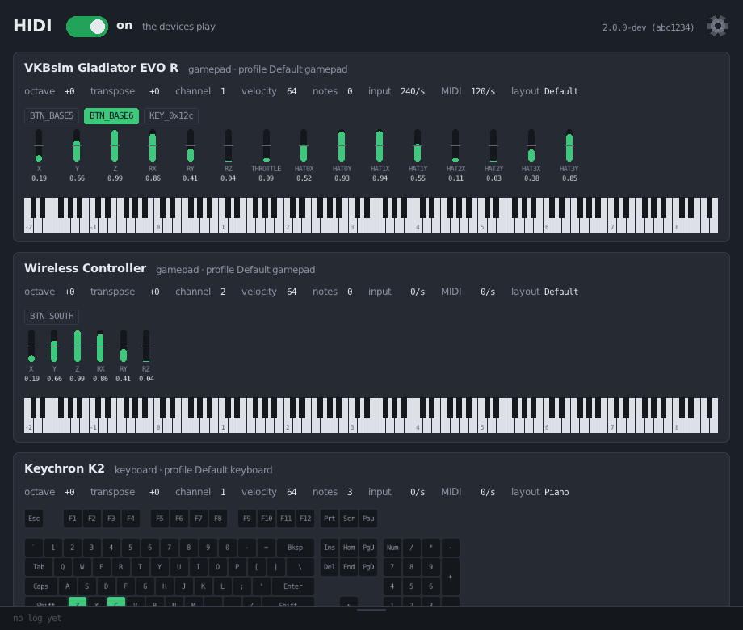
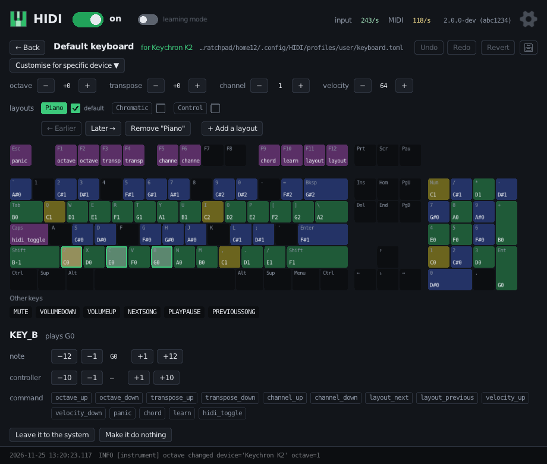

# HIDI

Flexible HID to MIDI translation layer: play your computer keyboard as a MIDI
instrument, and use game controllers for notes, pitch bend and control changes.


> **This is the development branch for HIDI 2.0.** It is a rebuild in
> progress: it can be tried on Linux, as described below, but is far from
> complete. For the released version, see the
> [`main` branch](https://github.com/gethiox/HIDI/tree/main) and the
> [releases page](https://github.com/gethiox/HIDI/releases).

## What 2.0 changes

- Runs on Linux and Windows 11 (25H2 or later).
- Every input device becomes its own MIDI device, which appears and disappears
  with the hardware.
- A terminal interface for headless use, plus a tray icon and a graphical
  interface.
- A new configuration format. Configuration files from HIDI 1.x are not
  compatible.

The structure is described in [docs/architecture.md](docs/architecture.md), and what is
done and what remains in [docs/roadmap.md](docs/roadmap.md).
The profile file format is described in [docs/configuration.md](docs/configuration.md).

## Building

HIDI needs Go 1.27 or later and no C toolchain.

```bash
go build ./cmd/hidi
```

Cross-compiling works with the usual Go variables, for example:

```bash
GOOS=windows GOARCH=amd64 go build ./cmd/hidi
```

## Trying it on Linux

HIDI reads input devices from `/dev/input` and creates MIDI devices through
the ALSA sequencer. Your user needs access to both, which on most
distributions means being a member of the `input` and `audio` groups:

```bash
sudo usermod -aG input,audio "$USER"
```

Log out and back in for the change to take effect.

List the input devices HIDI sees and the profile each would use:

```bash
./hidi devices
```

Run the instruments:

```bash
./hidi run
```

Every keyboard and game controller becomes a MIDI device named `HIDI`
followed by the device's name. It shows up in your DAW or synthesizer, and
in the output of `aconnect -l`. Unplugging the device removes it.

While HIDI is on, keyboards are taken away from the rest of the system, so
that playing does not type. That includes the keyboard you started HIDI
with. To get it back, turn HIDI off with the toggle combination:

**Left Ctrl + Left Shift + Left Alt**, pressed together.

Pressing it again turns HIDI back on. While HIDI is off the instruments are
silent, and the MIDI devices stay in place. To stop HIDI, turn it off and
press Ctrl+C. Game controllers are not taken away, so they keep working in
other programs.

| Option | Effect |
|---|---|
| `-toggle KEYS` | Use another combination, such as `-toggle KEY_SCROLLLOCK` or `-toggle KEY_LEFTCTRL+KEY_RIGHTCTRL`. |
| `-no-grab` | Leave keyboards usable by the system; they type while you play. |
| `-grab-gamepads` | Also take game controllers away from other programs. |
| `-off` | Start turned off. |
| `-v` | Also log details, such as every ignored device. |
| `-log-midi` | Also log every MIDI message sent. It is for finding faults: an instrument sends hundreds a second. |
| `-no-status` | Write the log only, without the lines about HIDI's state at the bottom of the terminal. |
| `-no-color` | Write the log without colours. |
| `-config DIR` | Use another directory for HIDI's settings and profiles. |
| `-profiles DIR` | Read profiles from another directory, beside the built-in ones. |
| `-connect PORT` | Also send to an existing MIDI port; see below. |

On a terminal, the last lines show what HIDI is doing: whether it is on, and
for every instrument its channel, octave, the notes that sound, and how many
events came in from the device and how many MIDI messages went out in the
last second. The log runs above them.


When the output goes to a file or a pipe, or with `-no-status`, only the log
is written.

The log is coloured when it goes to a terminal, and plain when it goes to a
file or a pipe. Besides `-no-color`, setting the `NO_COLOR` environment
variable turns the colours off; `FORCE_COLOR` keeps them when the output is
piped.

On its first start HIDI creates its directory, `~/.config/HIDI` on Linux and
`%AppData%\HIDI` on Windows, with its settings in `settings.toml` and the
profiles as files in `profiles`. `./hidi config` shows where they are. To
change what a device plays, edit its profile; HIDI picks up changes while it
runs. The settings give the defaults for the options above. Both formats are
[documented](docs/configuration.md).

### Lighting the keys

HIDI can show an instrument on the lights of its keyboard, through
[OpenRGB](https://openrgb.org), a program of its own that has to be running
with its SDK server turned on:

```
./hidi run -openrgb 127.0.0.1:6742
```

or `openrgb = true` under `[lights]` in the settings. HIDI does not come with
OpenRGB and works without it; the lights follow when the server runs, also
when it starts later.

- Keys that play are lit by what they play: every C in one colour, the other
  white keys of a piano in a second, the black ones in a third. Keys that do
  nothing are dim red.
- A key whose note sounds turns white.
- The command keys show state: the octave and transpose keys grow brighter
  the further they have been used, the layout keys dim at the first and last
  layout, the channel keys take the colour of the channel, panic is red.
- While HIDI is off the keyboard is lit evenly, and types.

With the lights on, each instrument's MIDI device can also be sent to. Notes
another program sends there, a DAW playing a track for one, light the keys
that would play them: white on the instrument's own channel, in the colour
of their channel otherwise. On Windows that part is not there yet.
### Beside an input remapper

A program such as [input-remapper](https://github.com/sezanzeb/input-remapper)
takes a keyboard for itself and passes its keys on through a device of its
own, named like "input-remapper ... forwarded". HIDI then gets nothing from
the keyboard itself and says so in its log; the instrument to play is the
forwarded one. What the remapper types by itself arrives through its
"input-remapper keyboard", which is an instrument too.

### Looking at a running HIDI

From another terminal:

```
./hidi status     # the instruments and their state
./hidi monitor    # the same, kept up to date, with the end of the log
./hidi off        # turn HIDI off, like the toggle combination
./hidi on
./hidi toggle
```

`hidi off` is useful as a desktop shortcut or from a script. `hidi monitor`
redraws in place on a terminal; piped, or with `NO_COLOR` set, it writes
each change below the last.

### The window

```
./hidi gui
```

opens a window with the instruments and a switch that turns HIDI on and off.
Each instrument shows its state, what its device reports, and the notes that
are played because of it. A keyboard is drawn as a full-size keyboard with
the keys that are down lit; keys that are down and not on the drawing are
named beside it. Every other device shows the buttons and axes it has
reported so far. Like the
terminal views it only looks at the running HIDI; closing it stops nothing,
and it waits for a HIDI that is not running yet.


The log lives in the bar at the bottom, which shows its last line, faint.
Pull the bar up, or click it, for the whole log, and choose the least severe
level to show.



The gear in the upper right corner opens the settings, and turns while they
are open. The page shows HIDI's settings, of which the switches and the frame
limit can be changed there; where the settings and profiles are kept, with
buttons that open those places in the file manager; and every profile, also
those of devices that are not connected, each with a button that opens its
file. A running HIDI takes the switches for grabbing over within a few
seconds; the others matter when it starts.


A profile is changed in the window too. "Edit profile" on an instrument, or
"Edit" beside a profile in the settings, opens it: the numbers an instrument
starts with, the layouts, and what every control does. A keyboard's profile
is drawn as a keyboard, coloured by what the keys do; other profiles list
their buttons. Click a control, or press it on the device, and make it play
a note, run a command, or do nothing. Every change is written to the file at
once, as a change of that one line: notes you wrote into the file by hand
stay. A running HIDI follows within a few seconds.



What a control sends besides notes and commands, a controller for one, and
keys that need a modifier, are shown where they apply and changed in the
file.

| Option | Meaning |
| --- | --- |
| `-settings` | Open with the settings showing. |
| `-edit FILE` | Open with this profile, ready to be changed. |
| `-background-fps N` | Draw at most N times a second while another window has the focus. Without it the window keeps to the monitor's refresh rate. |
| `-log-height N` | Open with the log pulled up N pixels. |

The window is drawn at the refresh rate of the monitor it is on, and only
when something it shows has changed, so an idle window costs next to
nothing. It never keeps the computer or the display awake.

The window needs 64-bit Linux or Windows with OpenGL 3.3, and a HIDI built
with `CGO_ENABLED=0`, which is how releases are built. It has not run on a
real display yet, only on a virtual one.

### An icon in the notification area

```
./hidi tray
```

shows an icon that tells whether HIDI is on, off or not running. A click
turns HIDI on or off, and its menu lists the instruments. The icon is a
program of its own next to `hidi run`: it may start first, stays when HIDI
stops, and removing it leaves HIDI running. Put it among the programs your
desktop starts at login.


On Linux the icon needs a desktop that shows such icons the modern way
(StatusNotifierItem): KDE, Xfce, the bars of Wayland compositors such as
Waybar, and GNOME with the AppIndicator extension. On Windows it works as it
is, and has not run on a real machine yet.

### Sending to a hardware MIDI interface

Every instrument is a MIDI device of its own that other programs connect to.
HIDI can also send straight to a MIDI port that already exists, such as a
USB MIDI interface with a synthesizer behind it, which is what a single-board
computer without a screen needs:

```
./hidi ports                      # what is there
./hidi run -connect "USB MIDI"    # send every instrument there as well
```

`-connect` takes a part of the port's name, or its ID from the first column
of `hidi ports`, and may be given several times. The port does not have to
exist yet: HIDI connects when it appears, and again after it was unplugged.

The default keyboard profile plays notes on the letter rows, changes octave
with F1 and F2, transposes with F3 and F4, changes channel with F5 and F6,
and switches layout with F11 and F12. F9 remembers the chord that is held, so
that every key plays it. Escape silences everything.

## Trying it on Windows

The Windows side is new, so expect it to need corrections. MIDI output has
created a device on one machine, and a DAW there played what was sent to it.
Reading keyboards and game controllers has not run on a real machine yet.

Start with `hidi doctor`, which checks MIDI output on its own:

```
hidi.exe doctor
```

It creates three MIDI devices, as HIDI makes one for every instrument, plays
on the first, removes them, and creates one more to see that removing left
the MIDI service working. `-devices N` changes how many. `-removal
disconnect` and `-removal release` try other ways of giving a device up, and
`-removal none` gives up nothing and leaves it to Windows to clear up when
the program ends. Before a device is removed it is left alone for half a
second, because removing one straight after using it has been seen to hang
the MIDI service; `-wait 0` or `-wait 2s` changes that time.

It prints the Windows build, where it found Windows MIDI Services, and each
stage of creating a MIDI device. If all stages pass, a device named
"HIDI test device" appears in other programs and plays a C major chord until
you press Ctrl+C. If a stage fails, or the program stops without a message,
the output up to that point says where.

Windows MIDI Services needs Windows 11 25H2 or later. Until Windows itself
ships the API, `Windows.Devices.Midi2.dll` has to be supplied. Take it, with
the `.pri` file next to it, from the NuGet package
`Windows.Devices.Midi2.<version>.nupkg` on the releases page of
[microsoft/MIDI](https://github.com/microsoft/MIDI/releases); the package is
a zip archive. Do not use the copy that Microsoft's Tools installer places
next to its own programs. The DLL has to be
in the same folder as `hidi.exe`, unless `hidi doctor` reports that it found
the API in Windows. A program started with `go run` lives in a temporary
folder, so either build it first (`go build -o hidi.exe ./cmd/hidi`) or set
the environment variable `HIDI_MIDI_DLL` to the full path of the DLL.

Once `hidi doctor` passes, `hidi.exe run -v` turns every keyboard and game
controller into an instrument, as on Linux; `hidi.exe devices` lists what it
found. Windows cannot keep one keyboard from typing and let
another type: while HIDI is on, no keyboard types. The toggle combination,
Left Ctrl + Left Shift + Left Alt, turns HIDI off and gives them back. To try
it without that, run `hidi.exe run -v -no-grab`; the keys then also type.

Game controllers always keep working in other programs on Windows;
`-grab-gamepads` has no effect there. Xbox controllers, and those that
imitate one, are read through XInput and are all named "Xbox controller";
Windows knows four of them at most. Every other controller is read as the
HID device it is.

## Development

- `main` holds the released 1.x code and is not changed until 2.0 is ready.
- `dev` is the integration branch for 2.0. Changes reach it only through pull
  requests.
- Every pull request must pass CI: `gofmt`, `go vet`, `staticcheck`, the tests,
  and builds for all supported targets.
- The tests that need the kernel's input and MIDI interfaces run in a virtual
  machine in CI. They include an end-to-end test (`internal/e2e`) that starts
  the real program, plays a keyboard created in software and checks the MIDI
  that arrives. On a Linux machine with `/dev/uinput` and the ALSA sequencer
  they also run locally, as root or with access to both:
  `go build -o /tmp/hidi ./cmd/hidi && HIDI_E2E_BINARY=/tmp/hidi go test ./internal/e2e`
- `scripts/vm-test.sh` runs those tests in a virtual machine of its own, for a
  machine or container without the two interfaces. It needs no hardware
  virtualisation; the comment at its top lists the packages.

Run the same checks locally before opening a pull request:

```bash
gofmt -l .
```

```bash
go vet ./...
```

```bash
go test -race ./...
```

## License

HIDI is released under **GPLv3**, see [LICENSE](./LICENSE).
