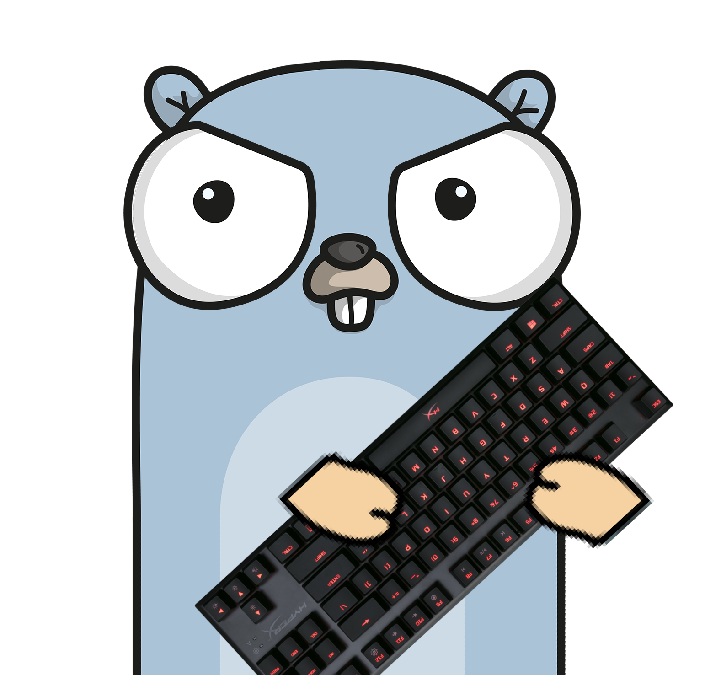
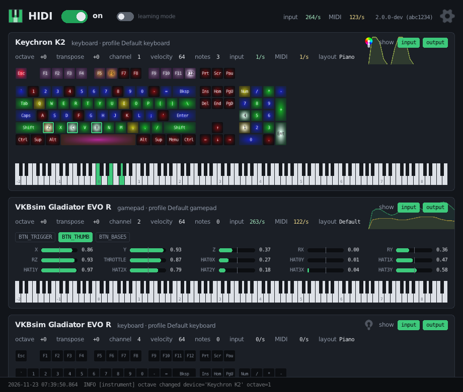

# HIDI

HIDI turns computer keyboards and game controllers into MIDI instruments.
Play notes on the letter keys, bend pitch with a stick, send control changes
from a throttle: every input device becomes a MIDI device of its own that a
DAW or a synthesizer can listen to.



> **This is HIDI 2.0 before its release.** It runs on Linux and on
> Windows 11, where it is a preview. The released version is 1.x, on the
> [`main` branch](https://github.com/gethiox/HIDI/tree/main) and the
> [releases page](https://github.com/gethiox/HIDI/releases). Configuration
> files from HIDI 1.x do not work with 2.0.



## What it does

- Every keyboard and game controller becomes one MIDI device, named `HIDI`
  followed by the device's name. It appears when the device is plugged in
  and goes when it is unplugged.
- Keyboards do not type while you play them. A key combination turns HIDI
  off and gives them back, and on again.
- What each key, button and axis does is written in a profile, a text file
  for each kind of device. HIDI follows changes to it while it runs, and the
  window can change it for you.
- It runs as an icon in the tray with a window, or in a terminal on a
  machine without a screen.
- It can send to a hardware MIDI interface directly, and light the keys of a
  keyboard by what they play.

## Contents

- [Installing](#installing)
- [Starting HIDI](#starting-hidi)
- [Playing](#playing)
- [The window](#the-window)
- [In a terminal](#in-a-terminal)
- [Settings and profiles](#settings-and-profiles)
- [Sending to a hardware MIDI interface](#sending-to-a-hardware-midi-interface)
- [Lighting the keys](#lighting-the-keys)
- [Windows](#windows)
- [When something does not work](#when-something-does-not-work)
- [Building from source](#building-from-source)

More to read: the [configuration reference](docs/configuration.md) for the
settings and the profile format, [how HIDI is built](docs/architecture.md),
and [what is done and what remains](docs/roadmap.md).

## Installing

HIDI is one program file, `hidi` (`hidi.exe` on Windows), without
dependencies. Take the archive for your system from the
[releases page](https://github.com/gethiox/HIDI/releases) and unpack it, or
[build it from source](#building-from-source).

### Linux

HIDI reads input devices from `/dev/input` and creates MIDI devices through
the ALSA sequencer. It does not need root. It needs your user to have access
to both; most distributions give sound to whoever is logged in at the
machine already. For the input devices there are two ways.

The udev rule that comes with HIDI, `70-hidi.rules`, gives them to whoever
is logged in at the machine's own screen and keyboard, for as long as they
are:

```bash
sudo cp 70-hidi.rules /etc/udev/rules.d/
```

```bash
sudo udevadm control --reload
```

```bash
sudo udevadm trigger --subsystem-match=input --subsystem-match=misc
```

Or make your user a member of the `input` group, and of `audio` where sound
is not handed out by login, then log out and back in:

```bash
sudo usermod -aG input,audio "$USER"
```

Either way, every program you run can then read every key pressed on the
machine, which programs under X11 can do anyway.

`hidi.desktop` is an entry for the desktop's menu. Copy it to
`~/.local/share/applications/` once `hidi` is somewhere on your `PATH`.

### Windows

HIDI needs Windows 11 25H2 or later, because it creates its MIDI devices
through Windows MIDI Services. See [Windows](#windows) for what else there
is to know before the first start.

## Starting HIDI

Start `hidi` from the desktop's menu, by a double click, or from a terminal:

```bash
hidi
```

The instruments run, and an icon appears in the tray. No window opens.

- A click on the icon opens the window.
- A click with the middle button turns HIDI off and on.
- The icon's menu lists the instruments, turns HIDI on and off, and ends it
  with "Quit HIDI".
- The colour of the icon tells whether HIDI is on or off.

To have the window open on every start, turn on "The window opens when HIDI
starts" in the settings; `hidi --window` does it once. Starting `hidi` while
it runs already opens the window of the one that runs.

On Linux the icon needs a desktop that shows such icons the modern way
(StatusNotifierItem): KDE, Xfce, the bars of Wayland compositors such as
Waybar, and GNOME with the AppIndicator extension. On a desktop without one,
HIDI opens its window instead, and closing the window ends HIDI.

For a machine without a screen, or to have nothing but the instruments, see
[In a terminal](#in-a-terminal).

## Playing

With the profiles HIDI comes with, a keyboard plays notes on its letter
rows, laid out like a piano.

| Keys | What they do |
|---|---|
| F1, F2 | Octave down, up |
| F3, F4 | Transpose down, up |
| F5, F6 | MIDI channel down, up |
| F9 | Remember the chord that is held; every key then plays it |
| F11, F12 | Previous, next layout |
| Escape | Silence everything |

A game controller plays notes on its buttons, bends the pitch with the left
stick, sends control changes from the other axes, and changes octave and
layout with the direction pad. What exactly, and everything else, is in the
[profiles](#settings-and-profiles).

### Turning HIDI off and on

While HIDI is on, keyboards are taken away from the rest of the system, so
that playing does not type. That includes the keyboard you started HIDI
with. To get it back, press the toggle combination:

**Left Ctrl + Left Shift + Left Alt**, together.

Pressing it again turns HIDI back on. While HIDI is off the instruments are
silent and their MIDI devices stay in place. Game controllers are not taken
away, so they keep working in other programs.

One key can do the same with a tap, Caps Lock for instance. Held for longer
than half a second, the key does what it normally does. What the rest of the
system sees of the tap differs between Windows and Linux; see "One key that
turns HIDI off and on" in the
[configuration reference](docs/configuration.md).

## The window

Each instrument has two lines: its name and profile, and its state. Behind
them runs a curve of the last twelve seconds, a tenth of a second at a
time: green for what came in from the device, yellow for what went out as
MIDI. The two numbers for it take
the same colours while they are not zero, and the top of the window has them
for all instruments together.
The switches "input" and "output" beside "show" add what the device reports
and the notes that are played because of it; the window remembers them for
every device.

A keyboard is drawn as a full-size keyboard. Every key has the colour of
what it does in the layout that is selected, and the keys that are down
stand out. Where HIDI lights the keyboard through OpenRGB, the keys also
glow in the colours of their lights, so the drawing shows what the keyboard
shows. Every other device shows the buttons and axes it has reported so far.
While HIDI is off, what is pressed shows in grey.


The switch at the top turns HIDI on and off.

The log lives in the bar at the bottom, which shows its last line, faint.
Pull the bar up, or click it, for the whole log, and choose the least severe
level to show.


### Settings

The gear in the upper right corner opens the settings as a sheet over the
instruments. A click beside the sheet closes it.


What is in `settings.toml` can be changed there. A running HIDI takes most
of it over within a few seconds; the page says what matters only at the next
start.

- "Change" beside the toggle combination takes a new one from the keyboard:
  press the keys together and let go. One key alone works too, and can then
  be made to work by a tap.
- "Devices that play" chooses which devices become instruments: with
  "blacklist" every one except those you tick, with "whitelist" only those
  you tick. The list has the devices
  that are connected and, in grey, those HIDI has seen before.
- "Also send to MIDI ports" lists the MIDI ports that exist. A click on one
  makes every instrument send there as well.
- "Colours of the keys" are the colours of the lights. Click one and move
  the three sliders; the keyboard follows when you let go.

Below them are the places where
settings and profiles are kept, with buttons that open them in the file
manager, and every profile, also those of devices that are not connected.

The window is drawn at the refresh rate of the monitor it is on, and only
when something it shows has changed, so an idle window costs next to
nothing. "Frame limit" lowers that rate, and "Frame limit while the window
is unfocused" lowers it only while another window is in use.

### Changing a profile

"Edit profile" on an instrument, or "Edit" beside a profile in the settings,
opens the profile: the numbers an instrument starts with, the layouts, and
what every control does. A keyboard's profile is drawn as a keyboard,
coloured by what the keys do; other profiles list their buttons and axes.
Click a control, or press it on the device, and make it play a note, send a
controller, run a command, or do nothing. An axis sends a controller or
bends the pitch, and has switches for resting in the middle and for being
reversed, and a dead zone.


Nothing is written until you save, with the disk in the corner or Ctrl+S.
The disk is yellow while there is something to save. A running HIDI plays
with the profile as it is shown, saved or not, so a change can be tried at
once; the file counts again when you take the changes back. "Undo" and
"Redo", or Ctrl+Z and Ctrl+Y, go back and forth through the changes. If you
leave the page with changes on it they stay there, and a yellow dot on the
way back to it says so.

The row of layouts chooses the one that is shown. The box beside a layout
makes it the one an instrument starts with. Below it are the buttons that
move the layout earlier or later in the row the player steps through, remove
it, and add a new one.

The keys for all this reach the window only while the keyboard is not
HIDI's alone: turn HIDI off, or use the buttons.

Saving changes the lines that changed and nothing else: notes you wrote into
the file by hand stay. Program changes, keys that need a modifier, the two
directions of an axis bound apart, and the options of a note are shown where
they apply and changed in the file. So is making a new profile.

The window needs 64-bit Linux or Windows with OpenGL 3.3.

## In a terminal

```bash
hidi --headless
```

runs the instruments only, without the icon and the window, until Ctrl+C.
`hidi run` is another way to write it. The last lines of the terminal show
what HIDI is doing: whether it is on, and for every instrument its channel,
octave, the notes that sound, and how many events came in from the device
and how many MIDI messages went out in the last second. The log runs above
them.


Remember that the keyboard you type on stops typing: turn HIDI off with the
toggle combination before pressing Ctrl+C, or start with `--no-grab`.

Options are written with two dashes, `--no-grab` or
`--toggle=KEY_CAPSLOCK`; those of one letter take one, `-v`. They are the
same for `hidi` and `hidi --headless`, and each overrides its setting in
`settings.toml` for this start.

| Option | Effect |
|---|---|
| `--headless` | Run the instruments only, without the icon and the window. |
| `--window` | Open the window at once. |
| `--toggle KEYS` | Use another combination, such as `--toggle KEY_SCROLLLOCK` or `--toggle KEY_LEFTCTRL+KEY_RIGHTCTRL`. |
| `--toggle-tap` | The toggle is one key and works by a tap. |
| `--always-grab` | Linux: keep keyboards grabbed while HIDI is off too, so that the tapped key is hidden from the system. |
| `--no-grab` | Leave keyboards usable by the system; they type while you play. |
| `--grab-gamepads` | Also take game controllers away from other programs. |
| `--off` | Start turned off. |
| `--connect PORT` | Also send to an existing MIDI port; see below. |
| `--openrgb ADDRESS` | Light the keys through OpenRGB; see below. |
| `--config DIR` | Use another directory for HIDI's settings and profiles. |
| `--profiles DIR` | Read profiles from another directory, beside the built-in ones. |
| `-v`, `--verbose` | Also log details, such as every ignored device. |
| `--log-midi` | Also log every MIDI message sent. It is for finding faults: an instrument sends hundreds a second. |
| `--no-status` | Write the log only, without the lines about HIDI's state. |
| `--no-color` | Write the log without colours. |

The log is coloured when it goes to a terminal, and plain when it goes to a
file or a pipe; then the lines about the state are left out too. Setting the
`NO_COLOR` environment variable turns the colours off; `FORCE_COLOR` keeps
them when the output is piped.

### Looking at a running HIDI

From another terminal, or from a script:

| Command | What it does |
|---|---|
| `hidi status` | Show the instruments and their state. |
| `hidi monitor` | The same, kept up to date, with the end of the log. |
| `hidi off`, `hidi on`, `hidi toggle` | Turn HIDI off or on, like the toggle combination. |
| `hidi gui` | Open the window. |
| `hidi tray` | Show an icon for a HIDI that runs without one. |
| `hidi devices` | List the input devices and the profile each would use. |
| `hidi ports` | List the MIDI ports HIDI can also send to. |
| `hidi config` | Show where the settings and profiles are. |
| `hidi profiles` | List the profiles and what is wrong with those that cannot be used. |
| `hidi doctor` | Check that this system can do what HIDI needs. |

`hidi off` is useful as a desktop shortcut. `hidi <command> --help` lists
the options of a command.

`hidi gui` and `hidi tray` only look at the running HIDI: closing them stops
nothing, and they wait for a HIDI that is not running yet. The icon of
`hidi tray` turns HIDI on and off with a click, and removing it leaves HIDI
running. It is for a HIDI started with `--headless`, by a service for
instance.


## Settings and profiles

On its first start HIDI creates its directory, `~/.config/HIDI` on Linux and
`%AppData%\HIDI` on Windows:

- `settings.toml` holds HIDI's own settings: the toggle, what is grabbed,
  where else to send, the window.
- `profiles` holds one file for each kind of device, which says what its
  keys, buttons and axes do.

`hidi config` shows where they are, and the settings in the window have
buttons that open them. To change what a device plays, edit its profile, by
hand or in the window; HIDI picks up changes while it runs. Both formats
are described in the [configuration reference](docs/configuration.md).

## Sending to a hardware MIDI interface

Every instrument is a MIDI device of its own that other programs connect to.
HIDI can also send straight to a MIDI port that already exists, such as a
USB MIDI interface with a synthesizer behind it, which is what a
single-board computer without a screen needs:

```bash
hidi ports
```

```bash
hidi --headless --connect "USB MIDI"
```

`--connect` takes a part of the port's name, or its ID from the first column
of `hidi ports`, and may be given several times; `connect` under `[output]`
in the settings does the same for every start. The port does not have to
exist yet: HIDI connects when it appears, and again after it was unplugged.
This works on Linux only so far.

## Lighting the keys

HIDI can show an instrument on the lights of its keyboard, through
[OpenRGB](https://openrgb.org), a program of its own that has to be running
with its SDK server turned on:

```bash
hidi --openrgb 127.0.0.1:6742
```

or `openrgb = true` under `[lights]` in the settings. HIDI does not come
with OpenRGB and works without it; the lights follow when the server runs,
also when it starts later.

- Keys that play are lit by what they play: every C in one colour, the other
  white keys of a piano in a second, the black ones in a third. Keys that do
  nothing are dim red.
- A key whose note sounds turns white.
- The command keys show state: the octave and transpose keys grow brighter
  the further they have been used, the layout keys dim at the first and last
  layout, the channel keys take the colour of the channel, panic is red.
- Keys that are left to the system have a colour of their own.
- While HIDI is off the keyboard is lit evenly, and types; a key that is
  held lights up.

Every one of these colours can be changed, in the window's settings or under
`[lights.colours]` in `settings.toml`.

How fast the lights follow is up to the keyboard, which takes some tens of
milliseconds to be written. HIDI sends a change at once and the next one as
soon as OpenRGB has taken the one before, so nothing queues up behind a slow
keyboard.

With the lights on, each instrument's MIDI device can also be sent to. Notes
another program sends there, a DAW playing a track for one, light the keys
that would play them: white on the instrument's own channel, in the colour
of their channel otherwise. On Windows that part is not there yet.

## Windows

**HIDI on Windows is a preview.** It rests on Windows MIDI Services, the new
MIDI system of Windows 11, which is itself new and still has faults. Expect
rough edges, and please report what you find.

### What is needed

- Windows 11 25H2 or later.
- The Windows MIDI Services API. `hidi doctor` says whether it found it in
  Windows. Where it did not, `Windows.Devices.Midi2.dll` has to lie in the
  same folder as `hidi.exe`. Take it, with the `.pri` file next to it, from
  the NuGet package `Windows.Devices.Midi2.<version>.nupkg` on the releases
  page of [microsoft/MIDI](https://github.com/microsoft/MIDI/releases); the
  package is a zip archive. Do not use the copy that Microsoft's Tools
  installer places next to its own programs.

### What is different from Linux

- **No keyboard types while HIDI is on.** Windows cannot keep one keyboard
  from typing and let another type. The toggle combination gives them all
  back.
- **A grabbed keyboard is told apart by where you last typed.** While
  keyboards are kept from typing, Windows does not say which keyboard a key
  comes from. The keys go to the instrument of the keyboard that typed last
  before HIDI was turned on. With one keyboard this does not matter. With
  two, turn HIDI off, press a key on the one you want to play, and turn it
  on again. With `--no-grab` every keyboard is its own instrument at all
  times, and types while you play.
- **Game controllers always keep working in other programs.**
  `--grab-gamepads` has no effect.
- **Xbox controllers**, and those that imitate one, are read through XInput
  and are all named "Xbox controller"; Windows knows four of them at most.
  Every other controller is read as the HID device it is.
- Sending to existing MIDI ports (`--connect`, `hidi ports`) and receiving
  notes for the lights are not there yet.

### If MIDI stops working

The MIDI service of Windows has a fault, known to Microsoft
([microsoft/MIDI#1047](https://github.com/microsoft/MIDI/issues/1047),
[#1236](https://github.com/microsoft/MIDI/issues/1236)): after a program's
MIDI devices are removed, or the program ends, the service can hang. Then
HIDI takes long to end, the next start cannot create a MIDI device, and no
other program gets MIDI either. Microsoft has announced the repair for the
Windows update at the end of November 2026. Until a machine has it, this can
happen whenever HIDI stops, and HIDI cannot prevent it.

Restarting Windows clears it, but is not needed. `Restart-Service midisrv`
does not help, because the hung service does not stop. Ending its process
does; in a terminal opened as administrator:

```
taskkill /F /IM midisrv.exe
```

Windows starts the service again when a program asks for MIDI. A HIDI that
is running notices that the service was restarted and creates its MIDI
devices anew within a few seconds; a DAW may have to be told to look for
them again.

## When something does not work

```bash
hidi doctor
```

checks what HIDI needs, step by step, and says where it fails: whether the
input devices can be read, and whether a MIDI device can be created. It
creates three MIDI devices, plays a C major chord on the first, removes
them, and creates one more to see that removing left the MIDI system
working. On Windows it also prints the Windows build and where it found
Windows MIDI Services.

| What you see | What to try |
|---|---|
| No instruments | `hidi devices` lists what HIDI finds. On Linux, see [the access to input devices](#linux). |
| The keyboard does nothing | HIDI is on and has it. Press Left Ctrl + Left Shift + Left Alt together. |
| A device plays the wrong things | `hidi devices` names the profile it uses; change it, or write one for the device. |
| A profile is ignored | `hidi profiles` says what is wrong with it, line by line. |
| Nothing arrives in the DAW | Look for a MIDI input named `HIDI` and the device's name. On Linux, `aconnect -l` lists them. |
| HIDI ended badly | The next start names a file with what happened. Please include it when you report the fault. |

`hidi --headless -v` logs every device HIDI looked at and why it left it
alone, and `--log-midi` every MIDI message it sends.

### Valve's Steam Controller

On Linux the kernel's `hid-steam` driver presents Valve's controllers as
game controllers, and HIDI plays them with a profile of its own, "Steam
Controller": the stick bends the pitch, the trackpads and triggers send
controllers, the buttons and paddles play notes.

- Steam must not be running. While it is, it takes the controller for
  itself and the kernel takes the game controller away.
- The controller of 2015 works with any current kernel. While HIDI has it
  open, its pads stop moving the mouse.
- The controller of 2026 and the Steam Deck's controls need a kernel that
  knows them; for the controller of 2026 that is a very recent one. They
  start as a mouse and keyboard, and send nothing to HIDI until you hold
  the button with the three lines (Start) for half a second, which
  switches them to being a game controller. The same again switches back.
- The motion sensors show up as a part called "Motion Sensors"; the
  profile does not use them.

On Windows HIDI reads the controller of 2026 itself, by cable, by Bluetooth
and through its wireless receiver. Windows only sees a mouse and a keyboard
in it; HIDI tells the controller to stop being those and listens to what it
reports of its own. When HIDI ends, the controller is a mouse and a keyboard
again. Close Steam first: two programs telling the controller what to be do
not get along. This part was written from the Linux driver without a
controller at hand, so tell what you find.

The controller of 2015 and the Steam Deck's controls are not read on Windows
yet. With Steam running and its controller support turned on, Steam presents
them as an Xbox controller, which HIDI plays like any other.

### Beside an input remapper

A program such as [input-remapper](https://github.com/sezanzeb/input-remapper)
takes a keyboard for itself and passes its keys on through a device of its
own, named like "input-remapper ... forwarded". HIDI then gets nothing from
the keyboard itself and says so in its log; the instrument to play is the
forwarded one. What the remapper types by itself arrives through its
"input-remapper keyboard", which is an instrument too.

## Building from source

HIDI needs Go 1.27 or later and no C toolchain.

```bash
CGO_ENABLED=0 go build ./cmd/hidi
```

Without `CGO_ENABLED=0` the program is built without the window.
Cross-compiling works with the usual Go variables:

```bash
CGO_ENABLED=0 GOOS=windows GOARCH=amd64 go build ./cmd/hidi
```

### Checking a release

A release is an archive for each system, built by `scripts/release.sh`. The
result depends only on the source and the Go toolchain named in `go.mod`, so
building the same commit again gives the same files, byte for byte:

```bash
scripts/release.sh 2.0.0 dist
```

Compare `dist/SHA256SUMS` with the one of the release. The files of a
release also carry a build provenance attestation, a signed statement that
the release workflow built them from that commit:

```bash
gh attestation verify hidi-2.0.0-linux-amd64.tar.gz --repo gethiox/HIDI
```

### Working on HIDI

[docs/architecture.md](docs/architecture.md) describes how HIDI is built and
tested, and [docs/roadmap.md](docs/roadmap.md) what is done, what remains
and how the work is organised. Before a change is pushed it passes what CI
runs:

```bash
gofmt -l .
```

```bash
go vet ./...
```

```bash
go test -race ./...
```

The tests that need the kernel's input and MIDI interfaces run in a virtual
machine in CI, and locally with `scripts/vm-test.sh`.

## License

HIDI is released under **GPLv3**, see [LICENSE](./LICENSE).
